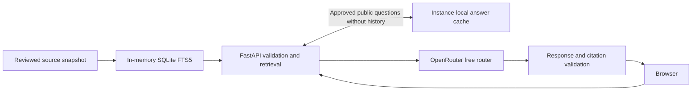

# Property Desk

A source-linked real estate chatbot for DarGlobal projects and selected Wasalt property information. It uses a dated factual snapshot, SQLite full-text retrieval and a free model through OpenRouter.

**Live app: [Property Desk](https://property-desk-chatbot.vercel.app)**

Example questions: "What is DarGlobal?", "Compare DG1 and Les Vagues amenities", and "How do I list a property on Wasalt?"

## Run locally

Tested with Python 3.14. Node.js 24 is used for JavaScript tests, not for the application runtime.

```powershell
python -m venv .venv
.\.venv\Scripts\python.exe -m pip install -r requirements-dev.txt
```

Create an ignored `.env` or `.env.local` using `.env.example`, and set `OPENROUTER_API_KEY`. Never put the real key in frontend code or commit it. Start the app:

```powershell
.\.venv\Scripts\python.exe -m app.run
```

Open **http://localhost:18770**. The local runner reads only the model key from local configuration. Production reads it from the process environment.

## How it works



- `app/main.py`: API routes, request/concurrency limits and public asset allowlist.
- `app/knowledge.py`: source-record validation and full-text retrieval.
- `app/chat.py`: bounded OpenRouter requests, citation validation and safe error categories.
- `app/cache.py`: one-hour caching for six approved public question types.
- `app/collect.py`: bounded HTTP collector with robots-policy and challenge checks.
- `web/`: responsive interface, browser history and source links; no frontend framework.

The model is `openrouter/free`; OpenRouter selects the underlying free model. There is no paid-model fallback, automatic application retry, model tool execution or unrestricted network access controlled by the model.

## Source data and collection

`data/knowledge.json` contains **23 curated factual records from 22 official pages**. The original nine records were collected on **19 November 2026**; fourteen additional pages were reviewed through web extraction on **20 November 2026**. Each record retains its own source URL, collection date and method. Extraction may use cached source content; the collection date does not establish live availability.

| Coverage | Included information |
| --- | --- |
| DarGlobal | Company overview and ten development/community overviews: DG1, Les Vagues, Tierra Viva, The Astera, Marea, AIDA, Urban Oasis, Da Vinci Tower, W Residences and Trump Tower Jeddah. Locations span the UAE, Qatar, Spain, Oman and Saudi Arabia. |
| Wasalt | Platform/listing services and nine property examples across Riyadh, Jeddah and Dammam: sale apartments, a villa, residential land and rental apartments. Monthly/yearly periods and land/built-up areas are distinguished. |

Try "The Astera amenities", "Compare Marea and Tierra Viva", "Wasalt Dammam Badr apartment", or "Al-Murooj monthly rent". Retrieval returns at most four sources, so broad answers describe a selection rather than the entire portfolio or market.

This is saved source information, not an exhaustive catalogue or live inventory. Conflicting size claims are retained; planned completion dates are developer statements. Confirm current prices and availability with the linked official sources. Seller/contact details, licence identifiers and street addresses are excluded.

```powershell
.\.venv\Scripts\python.exe -m app.collect
```

**Collection limitation:** source restrictions blocked all five pages in the recorded direct-HTTP collection run. The reviewed initial dataset came from web extraction. The collector now derives its deduplicated URL list from the validated snapshot, reviews each official URL once per run, and writes a private review report without replacing the dataset. The expanded URL list is covered by synthetic tests; a successful live direct-HTTP refresh is not claimed.

## History, caching and privacy

The sidebar focuses on recent chats, with secondary exploration under About this demo. Privacy and source notes expand beneath the compact composer; the saved-source notice stays visible. The conversation scrolls independently of the sidebar and composer.

Completed exchanges and citations are saved in localStorage for the current site/browser profile. Users can reopen or delete a conversation and confirm Clear all. New conversation preserves earlier chats. Limits are 20 conversations, the latest 40 messages each, and a 1 MB application payload. Storage failures leave the current chat usable with a warning.

Anyone using the same browser profile can read saved chats. They are not encrypted or synced across devices, and clearing site data can erase them. There are no accounts or server conversation database. Provider retention is separate from local deletion; avoid entering personal information.

The server cache accepts only exact approved public-question aliases, ignoring case, whitespace and terminal punctuation. Requests with conversation history or other wording bypass it. Only successful cited model answers are cached; hits retain the generating model and source links and display a saved-answer label. Arbitrary questions and conversation context are never stored in the shared cache.

Cache entries expire after one hour and disappear on process restart/deployment. Vercel instances do not share entries, and concurrent cold misses can each use quota. A cold cache cannot restore exhausted provider quota. Uncached AI requests send the question, up to four bounded context turns and selected source excerpts to OpenRouter/providers. Cached answers inherit the model answer's accuracy limits and do not make the snapshot live.

## API and safeguards

- `GET /api/health`: status, record count, snapshot date and mode.
- `POST /api/chat`: `{question, history: [{role, content}]}`; returns `{answer, sources, model, cached}`.
- Questions are limited to 1,200 characters; history to four user/assistant turns of 1,800 characters each; bodies to 16 KB.
- Input reading, provider time, response bytes and per-instance model concurrency are bounded. Model requests have a 40-second absolute deadline and a 4,096-token combined reasoning/answer allowance.
- Incomplete, invalid and uncited answers are rejected. Citation existence does not prove that every statement is supported. Browser output uses plain text and validated official-source links.
- HTTP errors distinguish invalid input, slow/oversized input, quota/concurrency limits, missing configuration and provider failure. Raw provider messages and credentials are not exposed.
- Public assets are explicitly allowlisted. HTTP caching stays disabled; the public-answer cache is application memory only. There is no distributed abuse limiter or shared daily quota enforcement.

## Docker

The root Dockerfile builds the chatbot:

```powershell
docker build -t property-desk:local .
docker run --rm --read-only -p 127.0.0.1:18771:8000 -e OPENROUTER_API_KEY property-desk:local
```

Forward the key from your terminal environment; the image does not load local environment files. Open **http://localhost:18771**. The image runs as UID 10001 and copies only runtime packages, Python source, the reviewed dataset and public web/font assets. Dependency versions are constrained; the base image tag is not digest-pinned.

For Vercel, use a separate production-only server secret for `OPENROUTER_API_KEY`. Prepare a fresh deployment directory:

```powershell
.\.venv\Scripts\python.exe scripts/prepare_release.py --output .private/release-example
```

The script copies exactly 21 allowlisted runtime files and never overwrites existing output. It excludes Git metadata, private working material, screenshots and local credentials. Deployment is manual and requires authorization; GitHub publication alone does not configure automatic deployment.

```powershell
# Replace YOUR_VERCEL_PROJECT with your intended Vercel project name.
vercel deploy --dry --format=json --project YOUR_VERCEL_PROJECT --cwd .private/release-example
vercel deploy --prod --yes --project YOUR_VERCEL_PROJECT --cwd .private/release-example
```

## Verification

```powershell
.\.venv\Scripts\python.exe -m pytest tests -q
.\.venv\Scripts\python.exe -m ruff check app scripts tests
.\.venv\Scripts\python.exe -m ruff check app scripts --select S
.\.venv\Scripts\python.exe -m mypy app scripts
.\.venv\Scripts\python.exe -m pip check
node --check web/app.js
node --test tests/*.test.mjs
docker build -t property-desk:local .
```

Current source checks passed: **86 Python tests and 17 JavaScript tests**, Ruff (including application/script security rules), mypy (eight source files), JavaScript syntax and dependency consistency. Unit tests make no live inference requests.

The 23-record coverage expansion is deployed. Vercel built the Docker image from 21 allowlisted runtime files. Anonymous checks verified three public assets against the reviewed release and a healthy API with 23 records and latest collection date 20 November 2026. A fresh uncached Astera question returned HTTP 200 with the new official project source. Comprehensive real-browser visual verification remains incomplete.

The root Dockerfile builds the expanded dataset successfully. A local read-only container ran as UID 10001, reported 23 records dated through 20 November, and denied private-file routes. Two live OpenRouter checks returned HTTP 200 with the intended new source: The Astera amenities and Al-Murooj monthly/yearly rent. Fourteen named-topic retrieval cases find their intended record within the first two results; this is a targeted regression set, not a general answer-accuracy benchmark. The previously checked read-only Linux container served five HTTP routes, handled missing configuration explicitly, and ran as UID 10001. Its inspected files contained no local credentials or working material. Cache behavior was exercised with synthetic model responses; live cache warming remains unverified.

Free quotas, provider capacity and latency can interrupt this public demo. Cross-browser, real-device, full accessibility, prolonged chatbot-idle and high-load verification remain incomplete. Hosting is serverless; continuous process uptime is not claimed. See [SPEC.md](SPEC.md) for the implemented requirements and decisions.

## Fonts and references

Newsreader headings and Public Sans body text are self-hosted, with system fallbacks and no external font requests. Original SIL Open Font License notices are included: [Newsreader](web/fonts/newsreader-OFL.txt) and [Public Sans](web/fonts/public-sans-OFL.txt). Font/colour/type tokens live in `web/style.css`; the interface is an independent research demo, not an official company website.

References: [FastAPI](https://fastapi.tiangolo.com/), [OpenRouter free router](https://openrouter.ai/docs/guides/routing/routers/free-router), [OpenRouter reasoning budgets](https://openrouter.ai/docs/guides/best-practices/reasoning-tokens), [OpenRouter rate limits](https://openrouter.ai/docs/api_reference/limits), [SQLite FTS5](https://sqlite.org/fts5.html).
